# Awesome Role-Based Access Control & Entitlements 🔐

 
 

 
 

**The curated directory of Role-Based Access Control (RBAC), Identity Governance &amp; Administration (IGA), Cloud Infrastructure Entitlement Management (CIEM), and Fine-Grained Authorization engines.**

> 🌟 **Welcome to the definitive guide on Access Control &amp; Entitlements!** Whether implementing enterprise-wide workforce RBAC, orchestrating policy-as-code microservices, or securing cloud infrastructure permissions, this curated collection covers leading SaaS platforms and actively maintained open-source frameworks.

---

## 📑 Table of Contents

- [🌐 Sector Overview & Market Dynamics](#-sector-overview--market-dynamics)
- [🟦 SaaS / Hosted Platforms](#-saas--hosted-platforms)
- [🟩 Open-Source Software](#-open-source-software)
  - [Keycloak](#1-keycloak)
  - [Authelia](#2-authelia)
  - [Casbin](#3-casbin)
  - [Open Policy Agent (OPA)](#4-open-policy-agent-opa)
  - [SpiceDB](#5-spicedb)
  - [OpenFGA](#6-openfga)
  - [Permify](#7-permify)
  - [OPAL (Permit.io)](#8-opal-policy-administration-layer)
  - [Ory Keto](#9-ory-keto)
  - [Pomerium](#10-pomerium)
  - [Cerbos](#11-cerbos)
  - [Gatekeeper](#12-gatekeeper-opa-for-kubernetes)
  - [Authorizer](#13-authorizer)
  - [Paralus](#14-paralus)
  - [OpenAM](#15-openam)
  - [Evolveum midPoint](#16-evolveum-midpoint)
  - [Apache Syncope](#17-apache-syncope)
- [📊 Comparison at a Glance](#-comparison-at-a-glance)
- [🤝 Contributing](#-contributing)
- [📄 License](#-license)

---

## 🌐 Sector Overview & Market Dynamics

The global **Identity & Access Management (IAM)** sector is valued at approximately **$25B–$29B** (growing at a 12–15% CAGR toward $70B+), while the specialized **Cloud Infrastructure Entitlement Management (CIEM)** and fine-grained authorization niche is experiencing hyper-growth, expanding from **$1.5B to over $7B** at a 35–44% CAGR. 

The market dynamics present a **moderately fragmented and bifurcated landscape**: core enterprise workforce authentication and identity governance are concentrated around incumbent mega-cap cybersecurity vendors (Microsoft, Okta, CyberArk, SailPoint), whereas cloud-native entitlements, fine-grained authorization (FGA), and Zanzibar-inspired relationship-based access control (ReBAC) remain highly fragmented, fast-moving, and driven by agile open-source engines and specialized security startups.

---

## 🟦 SaaS / Hosted Platforms

Commercial, enterprise-grade cloud platforms providing Role-Based Access Control (RBAC), Identity Governance and Administration (IGA), and Privileged Access/Entitlement Management.

*Sorted by company scale (Valuation / Market Capitalization) in descending order:*

| Product 🏢 | Company Scale (Valuation / Revenue) 📈 | Pricing (Starting Tier) 💵 | Free Tier / Trial Limit ⏱️ | Core Access Control & Entitlements Focus 🎯 |
|:---|:---|:---|:---|:---|
| **[Microsoft Entra ID](https://www.microsoft.com/en-us/security/business/identity-access/microsoft-entra-id)** | **$3.87T Market Cap** ($346.4B Annual Revenue) | **$7.00** per user/month (Entra ID P1 tier, billed annually) | **30-day free trial** (Includes up to 100 evaluation user licenses with full P1/P2 feature suite) | Enterprise directory, built-in/custom RBAC, Privileged Identity Management (PIM) with approval workflows, conditional access, and automated lifecycle governance. |
| **[CyberArk Identity](https://www.cyberark.com/products/identity-management/)** | **$21.1B Valuation** ($1.2B+ Annual Revenue) | **$4.00** per user/month (Workforce Standard tier, annual enterprise contract) | **14-day free trial** (Evaluation access to SSO, adaptive MFA, and role administration environment) | Privilege-centric RBAC, administrative rights delegation, role-scoped app access, credential vaulting, and fine-grained entitlement governance. |
| **[Okta](https://www.okta.com/)** | **$25.0B Market Cap** ($2.9B Annual Revenue) | **$6.00** per user/month (Workforce Starter tier, billed annually) | **30-day free trial** (Full sandbox tenant access to SSO, Universal Directory, MFA, and access control workflows) | Workforce and customer IAM, standard & custom admin roles, resource-scoped permissions, lifecycle management, and access entitlement certifications. |
| **[Auth0](https://auth0.com/)** *(by Okta)* | **$6.5B Acquisition Valuation** (Part of Okta $2.9B Revenue) | **$35.00** per month (B2C Essentials, up to 500 MAU) / **$150.00** per month (B2B Essentials) | **Free Forever Tier**: Up to **25,000 Monthly Active Users (MAUs)** with 1 Enterprise Connection, 5 Organizations, and unlimited social logins | Developer-first identity platform, fine-grained API authorization, dashboard RBAC roles (Admin, Editor, Viewer), multi-tenant organization scoping, and enterprise federation. |
| **[SailPoint Identity Security Cloud](https://www.sailpoint.com/)** | **$11.0B Valuation** ($1.17B Annual Revenue) | **$6.00** per identity/month (Business tier estimate, annual enterprise deployment) | **No public free tier**; Proof-of-concept (POC) sandbox provisioned via direct enterprise sales engagement | Dedicated Identity Governance & Administration (IGA), automated role mining, access requests & certifications, entitlement discovery, and AI-driven least-privilege compliance. |
| **[Ping Identity](https://www.pingidentity.com/)** | **$2.8B Acquisition Valuation** (Thoma Bravo / ForgeRock portfolio) | **$3.00** per user/month (PingOne Essential tier, annual workforce agreement) | **30-day free trial** (PingOne cloud evaluation tenant provisioned for up to 1,000 test identities) | Enterprise federated IAM, hierarchical admin roles, DaVinci zero-trust orchestration, granular permission identifiers, and hybrid cloud entitlement enforcement. |
| **[OneLogin](https://www.onelogin.com/)** *(by One Identity)* | **~$200M+ Estimated Valuation** (Part of Quest Software) | **$2.00** per user/month (Starter tier, billed annually) | **30-day free trial** (Complete platform access for testing cloud directory, application roles, and SCIM provisioning) | App-centric role management, attribute-based dynamic role mapping (e.g., department rules), automated user onboarding, and enterprise single sign-on. |

---

## 🟩 Open-Source Software

Self-hosted, community-driven access control engines, relationship-based authorization databases (Zanzibar), and policy-as-code decision points.

*Sorted by GitHub stargazers in descending order:*

| Project 📦 | Stars ⭐ | Primary Stack 🛠️ | License 📜 | Architecture Category 🏛️ |
|:---|:---|:---|:---|:---|
| **[Keycloak](https://github.com/keycloak/keycloak)** |  | Java | Apache-2.0 | Full IAM Platform with Realm/Client RBAC |
| **[Authelia](https://github.com/authelia/authelia)** |  | Go / TypeScript | Apache-2.0 | Lightweight Authentication & RBAC Reverse Proxy |
| **[Casbin](https://github.com/casbin/casbin)** |  | Multi-language (Go, Java, Python, Node, Rust) | Apache-2.0 | Embeddable Multi-Model (ACL, RBAC, ABAC) Library |
| **[Open Policy Agent (OPA)](https://github.com/open-policy-agent/opa)** |  | Go (Rego) | Apache-2.0 (CNCF Graduated) | General-Purpose Policy-as-Code Engine (PDP) |
| **[SpiceDB](https://github.com/authzed/spicedb)** |  | Go | Apache-2.0 | Google Zanzibar ReBAC Authorization Database |
| **[OpenFGA](https://github.com/openfga/openfga)** |  | Go | Apache-2.0 (CNCF Incubating) | Zanzibar-Inspired Fine-Grained Authorization Engine |
| **[Permify](https://github.com/Permify/permify)** |  | Go | Apache-2.0 | Zanzibar-Based Authorization Service with DSL |
| **[OPAL (Permit.io)](https://github.com/permitio/opal)** |  | Python / TypeScript | Apache-2.0 | Real-Time Policy Administration Layer for OPA/CEDAR |
| **[Ory Keto](https://github.com/ory/keto)** |  | Go | Apache-2.0 | Relationship-Based Access Control (ReBAC) Server |
| **[Pomerium](https://github.com/pomerium/pomerium)** |  | Go | Apache-2.0 | Identity-Aware Zero-Trust Access Proxy with RBAC |
| **[Cerbos](https://github.com/cerbos/cerbos)** |  | Go | Apache-2.0 | Stateless Context-Aware Policy Decision Point (PDP) |
| **[Gatekeeper](https://github.com/open-policy-agent/gatekeeper)** |  | Go | Apache-2.0 | Kubernetes Admission Controller & RBAC Enforcer |
| **[Authorizer](https://github.com/authorizerdev/authorizer)** |  | Go / React | Zlib / MIT | Cloud-Native Auth with Role & Session Management |
| **[Paralus](https://github.com/paralus/paralus)** |  | Go | Apache-2.0 (CNCF Sandbox) | Audited Kubernetes RBAC & Service Account Gateway |
| **[OpenAM](https://github.com/OpenIdentityPlatform/OpenAM)** |  | Java | CDDL-1.0 / Open Source | Access Management & Entitlements Engine |
| **[Evolveum midPoint](https://github.com/Evolveum/midpoint)** |  | Java | EUPL-1.2 / Open Source | Enterprise Identity Governance & Entitlement Lifecycle |
| **[Apache Syncope](https://github.com/apache/syncope)** |  | Java | Apache-2.0 | Comprehensive IGA Platform with Approval Workflows |

---

### 1. Keycloak
**Repo:** [keycloak/keycloak](https://github.com/keycloak/keycloak) |   
**Stack:** Java | **License:** Apache-2.0  
Keycloak is the standard for open-source Identity and Access Management. It delivers out-of-the-box support for realm-level roles, client-scoped roles, composite role hierarchies, and group-based role mappings. Its authorization services layer enables fine-grained permissions over resources, scopes, and policies (evaluating role, user, time, and aggregated criteria).  
* **Key Capabilities:** Realm & client roles, composite roles, SAML 2.0 / OpenID Connect, user federation (LDAP/AD), fine-grained authorization server.  
* **Best for:** Enterprise backends and microservices requiring a battle-tested, turn-key authentication and role authorization foundation.

### 2. Authelia
**Repo:** [authelia/authelia](https://github.com/authelia/authelia) |   
**Stack:** Go / TypeScript | **License:** Apache-2.0  
Authelia is an open-source authentication and authorization companion server that integrates directly with reverse proxies (Traefik, NGINX, Envoy, Caddy). It enforces role-based access rules and two-factor authentication before traffic reaches backend services.  
* **Key Capabilities:** Reverse proxy integration, YAML-based RBAC access rules per domain/path, WebAuthn/TOTP 2FA, OpenID Connect Provider.  
* **Best for:** DevOps teams and homelabbers looking to protect self-hosted web applications with lightweight reverse-proxy RBAC.

### 3. Casbin
**Repo:** [casbin/casbin](https://github.com/casbin/casbin) |   
**Stack:** Multi-language (Go, Java, Node.js, Python, PHP, Rust, .NET) | **License:** Apache-2.0  
Apache Casbin (Incubating) is an embeddable authorization library supporting multiple access control models defined via the PERM (Policy, Effect, Request, Matchers) DSL. It allows developers to switch between classic ACL, hierarchical RBAC (with role inheritance and domains/tenants), and ABAC without changing application code.  
* **Key Capabilities:** Zero network hops (in-process library), multi-tenant RBAC, role inheritance, persistent storage adapters (SQL, NoSQL).  
* **Best for:** Developers embedding fast, low-overhead RBAC/ABAC authorization checks directly inside monolithic or microservice codebases.

### 4. Open Policy Agent (OPA)
**Repo:** [open-policy-agent/opa](https://github.com/open-policy-agent/opa) |   
**Stack:** Go (Rego DSL) | **License:** Apache-2.0 (CNCF Graduated)  
OPA is the industry standard for general-purpose Policy-as-Code. By decoupling policy decisions from policy enforcement, OPA evaluates structured JSON data against declarative policies written in Rego. It can evaluate RBAC roles, attribute rules, and complex multi-factor authorization criteria in sub-millisecond response times.  
* **Key Capabilities:** Declarative Rego language, decoupled Policy Decision Point (PDP), high-throughput daemon or WebAssembly compilation, extensive telemetry.  
* **Best for:** Cloud-native microservices, CI/CD pipeline gating, API gateways, and unified policy enforcement across heterogeneous stacks.

### 5. SpiceDB
**Repo:** [authzed/spicedb](https://github.com/authzed/spicedb) |   
**Stack:** Go | **License:** Apache-2.0  
SpiceDB is an open-source, Google Zanzibar-inspired authorization database created by AuthZed for scalably storing and querying fine-grained permission data. It uses relationship tuples (`object#relation@subject`) and schema definitions to compute transitivity, role hierarchies, and organization entitlements with linear horizontal scaling.  
* **Key Capabilities:** Strict consistency control via ZedTokens (mitigates the "New Enemy" problem), p99 < 10ms check latency, schema validation, gRPC & REST APIs.  
* **Best for:** Multi-tenant SaaS products and collaborative enterprise apps requiring scalable relationship-based access control (ReBAC).

### 6. OpenFGA
**Repo:** [openfga/openfga](https://github.com/openfga/openfga) |   
**Stack:** Go | **License:** Apache-2.0 (CNCF Incubating)  
Originally developed by Auth0/Okta and contributed to the CNCF, OpenFGA is a high-performance authorization engine designed for developers. It models complex permissions—such as RBAC, ABAC, and ReBAC—using an intuitive modeling language, providing first-class APIs for single-check validations (`Check`) and object listings (`ListObjects`).  
* **Key Capabilities:** Human-readable DSL, SDKs for Node, Go, Python, Java, .NET, native `ListObjects` queries, pluggable storage backends (Postgres, MySQL, SQLite).  
* **Best for:** Engineering teams building modern cloud applications that require Google Zanzibar modeling without complex operational overhead.

### 7. Permify
**Repo:** [Permify/permify](https://github.com/Permify/permify) |   
**Stack:** Go | **License:** Apache-2.0  
Permify is an open-source authorization service based on Google Zanzibar. It allows developers to create custom authorization models combining RBAC, ReBAC, and ABAC attributes through a clear schema language. Permify handles real-time permission evaluation and distributed relationship tracking across microservices.  
* **Key Capabilities:** Flexible authorization DSL, relation and attribute evaluation, Jaeger tracing integration, multi-tenancy support.  
* **Best for:** Microservice architectures needing unified access control with both relationship graphs and dynamic attribute evaluation.

### 8. OPAL (Policy Administration Layer)
**Repo:** [permitio/opal](https://github.com/permitio/opal) |   
**Stack:** Python / TypeScript | **License:** Apache-2.0  
Created by Permit.io, OPAL acts as the administration and real-time synchronization layer for policy engines like Open Policy Agent (OPA) and AWS Cedar. While OPA evaluates policies statelessly, OPAL watches Git repos and application databases to push updated RBAC role definitions and policy state via WebSockets in milliseconds.  
* **Key Capabilities:** Real-time policy and data pushes, GitOps-driven policy tracking, decoupled data fetchers, zero-downtime policy reloads.  
* **Best for:** Teams operating distributed OPA decision points that need instant data updates whenever roles or user permissions change.

### 9. Ory Keto
**Repo:** [ory/keto](https://github.com/ory/keto) |   
**Stack:** Go | **License:** Apache-2.0  
Ory Keto is the authorization component of the popular Ory open-source security suite (alongside Kratos and Hydra). It implements Google Zanzibar relationship access control, exposing gRPC and REST endpoints to determine whether an entity has access based on hierarchical and graph relationships.  
* **Key Capabilities:** Ultra-fast sub-millisecond lookups, Zanzibar tuple architecture, seamless compatibility with Ory Kratos identity management.  
* **Best for:** Projects already utilizing the Ory ecosystem for user management looking for native relationship-based permission checks.

### 10. Pomerium
**Repo:** [pomerium/pomerium](https://github.com/pomerium/pomerium) |   
**Stack:** Go | **License:** Apache-2.0  
Pomerium is an identity-aware proxy that enforces Zero Trust Network Access (ZTNA) and role-based policies on internal enterprise applications. Acting as an ingress point, Pomerium verifies identity, groups, and contextual metadata on every HTTP request before routing traffic.  
* **Key Capabilities:** Context-aware RBAC policies, OIDC/IdP integration, clientless browser access, built-in Envoy proxy architecture.  
* **Best for:** Organizations replacing legacy VPNs with an identity-aware proxy that gates web services by user group and role.

### 11. Cerbos
**Repo:** [cerbos/cerbos](https://github.com/cerbos/cerbos) |   
**Stack:** Go | **License:** Apache-2.0  
Cerbos is a stateless Policy Decision Point (PDP) designed to take the complexity out of authorization logic. Policies are declared in intuitive YAML files specifying role and attribute conditions. The Cerbos daemon evaluates access requests in microseconds while remaining completely stateless.  
* **Key Capabilities:** Clean YAML policy definitions, contextual condition logic, query planner (translates authorization policies into SQL `WHERE` clauses), WebAssembly compilation.  
* **Best for:** Engineering teams that want simple, audit-ready YAML policy files without storing permission graph databases.

### 12. Gatekeeper (OPA for Kubernetes)
**Repo:** [open-policy-agent/gatekeeper](https://github.com/open-policy-agent/gatekeeper) |   
**Stack:** Go | **License:** Apache-2.0  
Gatekeeper is an admission controller webhook that integrates Open Policy Agent with Kubernetes. It provides validation and mutation policies to govern cluster access, enforce role separation, and inspect resource entitlements across namespaces.  
* **Key Capabilities:** Custom Resource Definition (CRD)-based policy templates, audit capabilities for cluster drift, declarative governance.  
* **Best for:** Kubernetes cluster administrators seeking automated enforcement of RBAC guardrails and pod security compliance.

### 13. Authorizer
**Repo:** [authorizerdev/authorizer](https://github.com/authorizerdev/authorizer) |   
**Stack:** Go / React | **License:** Zlib / MIT  
Authorizer is an open-source, lightweight authentication and authorization solution that can be deployed to any infrastructure (Kubernetes, Docker, Heroku). It provides a GraphQL and REST API with built-in role assignment, session management, and social logins.  
* **Key Capabilities:** Turn-key React login UI, role-based session tokens, multi-database support (Postgres, MySQL, DynamoDB, MongoDB).  
* **Best for:** Full-stack developers wanting an all-in-one Auth0 alternative with role management that can be self-hosted in minutes.

### 14. Paralus
**Repo:** [paralus/paralus](https://github.com/paralus/paralus) |   
**Stack:** Go | **License:** Apache-2.0 (CNCF Sandbox)  
Paralus is a security platform offering centralized access management for Kubernetes infrastructure. It integrates with corporate IdPs to deliver just-in-time service accounts, dynamic role assignment, and granular audit logging across clusters, projects, and namespaces.  
* **Key Capabilities:** Centralized multi-cluster RBAC, dynamic permission revocation, zero-trust CLI/API access proxy, complete audit trails.  
* **Best for:** Cloud infrastructure teams managing access across dozens of distributed Kubernetes clusters with strict compliance needs.

### 15. OpenAM
**Repo:** [OpenIdentityPlatform/OpenAM](https://github.com/OpenIdentityPlatform/OpenAM) |   
**Stack:** Java | **License:** CDDL-1.0 / Open Source  
OpenAM (maintained by Open Identity Platform, continuing the Sun/ForgeRock OpenAM heritage) provides full access management, single sign-on, identity federation, and fine-grained entitlement management for web applications and web services.  
* **Key Capabilities:** Native entitlement engine, policy script evaluation, Cross-Domain SSO (CDSSO), SAML 2.0/OIDC integration.  
* **Best for:** Organizations maintaining complex legacy or hybrid cloud enterprise application suites requiring formal entitlement management.

### 16. Evolveum midPoint
**Repo:** [Evolveum/midpoint](https://github.com/Evolveum/midpoint) |   
**Stack:** Java | **License:** EUPL-1.2 / Open Source  
Evolveum midPoint is a comprehensive open-source Identity Governance and Administration (IGA) platform. Unlike pure authorization libraries, midPoint manages the full lifecycle of roles, organizational structures, temporal assignments (temporary access with expiration), and automated request/approval certifications.  
* **Key Capabilities:** Deep identity governance, temporal RBAC constraints, ConnId connectors for provisioning, approval workflows, compliance auditing.  
* **Best for:** Government, university, and large enterprise environments requiring a complete, self-hosted IGA and role-governance control plane.

### 17. Apache Syncope
**Repo:** [apache/syncope](https://github.com/apache/syncope) |   
**Stack:** Java | **License:** Apache-2.0  
Apache Syncope is an open-source digital identity management system that handles identity lifecycle, role provisioning, and entitlement administration across heterogeneous corporate networks. It includes a built-in workflow engine (Flowable) for orchestrating multi-step approval requests when users require elevated role assignments.  
* **Key Capabilities:** Native role & entitlement management, workflow-based approval pipelines, SCIM 2.0 / SAML / OIDC connectors, multi-tenancy.  
* **Best for:** Organizations needing a 100% Apache-licensed, full-featured IGA solution with native request-approval workflows.

---

## 📊 Comparison at a Glance

| Platform / Engine | Type | Primary Authorization Model | Self-Hosted | Dynamic Approval Workflows | Primary Use Case |
|:---|:---|:---|:---:|:---:|:---|
| **Microsoft Entra ID** | Cloud SaaS | RBAC + Conditional Access | ❌ | ✅ (PIM) | Microsoft 365 & enterprise Azure identity |
| **CyberArk Identity** | Cloud SaaS | Privilege-Centric RBAC | ❌ | ✅ | Privileged workforce & administrative control |
| **Okta** | Cloud SaaS | Enterprise RBAC | ❌ | ✅ (Workflows) | Enterprise-wide workforce & customer IAM |
| **Auth0** | Cloud SaaS | Developer RBAC / Scopes | ❌ | ❌ | SaaS application auth & multi-tenant orgs |
| **SailPoint Identity** | Cloud SaaS | IGA Role & Entitlement Governance | ❌ | ✅ | Compliance certifications & role lifecycle |
| **Ping Identity** | Cloud SaaS | Hierarchical RBAC | ❌ | ✅ | Hybrid cloud orchestration & federated IAM |
| **OneLogin** | Cloud SaaS | Application-Centric RBAC | ❌ | ❌ | Directory-driven app mapping & SSO |
| **Keycloak** | Open-Source | Realm/Client RBAC + Resource Scopes | ✅ | ❌ | General enterprise identity & application SSO |
| **Authelia** | Open-Source | Domain & Path-based RBAC | ✅ | ❌ | Reverse-proxy authentication gateway |
| **Casbin** | Open-Source | Multi-Model (ACL, RBAC, ABAC) | ✅ | ❌ | Fast in-process library authorization |
| **Open Policy Agent** | Open-Source | Policy-as-Code (Rego) | ✅ | ❌ | Decoupled cloud-native policy decisions (PDP) |
| **SpiceDB** | Open-Source | ReBAC (Zanzibar graph tuples) | ✅ | ❌ | Scalable fine-grained permission database |
| **OpenFGA** | Open-Source | ReBAC / Fine-Grained Authorization | ✅ | ❌ | Developer-friendly Zanzibar authorization |
| **Permify** | Open-Source | ReBAC + ABAC DSL | ✅ | ❌ | Microservice relationship permission server |
| **OPAL (Permit.io)** | Open-Source | Policy Administration Layer | ✅ | ❌ | Real-time policy and state push for OPA |
| **Ory Keto** | Open-Source | ReBAC (Zanzibar) | ✅ | ❌ | Ory stack relationship authorization |
| **Pomerium** | Open-Source | Contextual RBAC / ZTNA | ✅ | ❌ | Zero-trust identity proxy for internal services |
| **Cerbos** | Open-Source | Context-Aware Policy (YAML) | ✅ | ❌ | Stateless decision point for business logic |
| **Gatekeeper** | Open-Source | Rego Admission Control | ✅ | ❌ | Kubernetes cluster RBAC & admission policies |
| **Authorizer** | Open-Source | Role-based Session Auth | ✅ | ❌ | Fast turn-key auth with role assignments |
| **Paralus** | Open-Source | Kubernetes Cluster RBAC | ✅ | ❌ | Zero-trust Kubernetes access management |
| **OpenAM** | Open-Source | Access Management & Entitlements | ✅ | ❌ | Enterprise SSO & web entitlement engine |
| **Evolveum midPoint** | Open-Source | Temporal RBAC & Full IGA | ✅ | ✅ | Enterprise governance & credential lifecycle |
| **Apache Syncope** | Open-Source | Role & Entitlement Management | ✅ | ✅ | Open-source IGA with approval workflows |

---

## 🤝 Contributing

Contributions are warmly welcome! Help keep this repository the authoritative, up-to-date guide for Role-Based Access Control and Entitlement Management:

1. **Fork the repository** on GitHub.
2. **Review criteria**:
   - Project must be actively maintained (commits or releases within the past 12 months).
   - Must provide concrete RBAC, IGA, ReBAC, or entitlement functionality.
   - For open-source tools, include the stack, license, and public GitHub repository link.
3. **Submit a pull request** with clear, concise descriptions.

---

## 📄 License

This repository and compilation are licensed under the [Creative Commons Zero v1.0 Universal (CC0 1.0)](https://creativecommons.org/publicdomain/zero/1.0/) Public Domain Dedication. Listed third-party products, projects, and trademarks belong to their respective copyright holders.

---

⭐ **Found this guide helpful? Please star this repository to support the community!** ⭐

